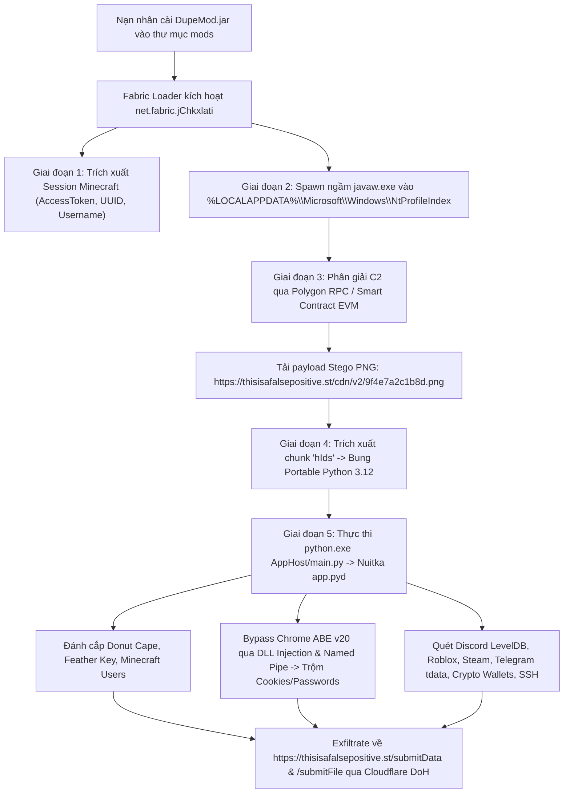

# Author: tdinh cute
# Research & Analysis by tdinh

# 🚨 BÁO CÁO PHÂN TÍCH FORENSIC MÃ ĐỘC: DUPEMOD.JAR (MINECRAFT DONUT CAPE & SESSION STEALER)

> **Phân tích bởi:** tdinh
> **Decoded by:** tdinh cute
> **Đối tượng:** `DupeMod.jar` (1.3 MB)
> **Phân loại mã độc:** Fake Mod Trojan Horse / Multi-Stage Advanced InfoStealer & RAT
> **Mục tiêu chính:** Đánh cắp DonutSMP Cape, Minecraft Microsoft Session Tokens, Discord Tokens, Trình duyệt (vượt Chrome v20 App-Bound Encryption), Steam, Roblox, Telegram, Ví tiền điện tử (Crypto Wallets) & SSH Keys.

---

## 1. TỔNG QUAN VỤ VIỆC (EXECUTIVE SUMMARY)

Kẻ tấn công tạo ra một file mod giả mạo mang tên **`DupeMod.jar`** nhằm dụ dỗ các người chơi Minecraft (đặc biệt là cộng đồng server DonutSMP hoặc các server PvP/Survival) tải về với lời hứa hẹn "dupe đồ".

**Thực tế:** File này **100% không chứa bất kỳ tính năng mod hay dupe đồ nào**. Toàn bộ mã nguồn bên trong là một chuỗi tấn công tinh vi gồm **5 giai đoạn (5-Stage Stager)**, sử dụng:
1. **Java Reflection & ClassLoader Detached Process:** Trộm session game ngay khi khởi động Fabric và tự spawn một tiến trình ngầm tách rời (detached process).
2. **Blockchain Dead-Drop C2 Resolver:** Truy vấn các node RPC của mạng Polygon (Matic) để đọc địa chỉ C2 động qua Smart Contract EVM (Function selector `0xce6d41de`), né tránh việc bị chặn tên miền tĩnh.
3. **Steganography Polyglot Image Dropper:** Tải về một file ảnh PNG (`9f4e7a2c1b8d.png`) chứa payload nhúng trong chunk ảnh tùy biến `hIds` (nén zlib).
4. **Embedded Portable Python 3.12 Runtime:** Tự bung giải nén một môi trường Python 3.12 đầy đủ mà nạn nhân không hề hay biết vào `%LOCALAPPDATA%\Microsoft\Windows\NtProfileIndex`.
5. **Nuitka C-Extension InfoStealer (`app.pyd`):** Mã độc được biên dịch sang C-extension bằng Nuitka, mã hóa toàn bộ chuỗi hằng số bằng bảng S-box lookup kiểm tra CRC32 (`0x92fb69d4`). Module này sở hữu kỹ thuật tiêm DLL vào tiến trình trình duyệt Chrome thông qua Named Pipe để bẻ khóa công nghệ **Chrome v20 App-Bound Encryption (ABE)** mới nhất của Google.

---

## 2. KIẾN TRÚC VÀ CÁC GIAI ĐOẠN TẤN CÔNG (ATTACK CHAIN)



---

## 3. BÓC TÁCH CHI TIẾT CÁC THÀNH PHẦN

### Giai đoạn 1: Tệp JAR mồi nhử & File Inflation
- File `.jar` có kích thước ~1.31 MB nhưng chỉ có 5 class Java nhỏ.
- Kẻ tấn công nhét file rác `assets/iuxmhira.dat` (kích thước **1,245,184 bytes**, entropy tuyệt đối 7.9999) nhằm mục đích **File Inflation / Bloating** (thổi phồng dung lượng file để vượt qua giới hạn quét tự động của một số trình antivirus và tạo cảm giác như một mod game thật).
- Entrypoint Fabric: `net.fabric.jChkxlati`
- Manifest Main-Class: `net.fabric.idxGubmngg`

### Giai đoạn 2: Trộm Session & Spawn Detached Process
- Class [`sJqeuctwv.java`](file:///d:/THAY%20THẾ/deobf/output/decompiled_dupemod/net/fabric/sJqeuctwv.java):
  Sử dụng Java Reflection truy cập sâu vào internal của Fabric/Minecraft (`net.minecraft.client.MinecraftClient`):
  ```java
  MinecraftClient.getInstance().getSession().getAccessToken();
  MinecraftClient.getInstance().getSession().getUsername();
  MinecraftClient.getInstance().getSession().getUuidOrNull();
  ```
  Nhằm chiếm đoạt ngay lập tức token đăng nhập Microsoft OAuth của tài khoản game.
- Class [`idxGubmngg.java`](file:///d:/THAY%20THẾ/deobf/output/decompiled_dupemod/net/fabric/idxGubmngg.java):
  Tạo thư mục ẩn và chuyển hướng đầu ra:
  ```
  %LOCALAPPDATA%\Microsoft\Windows\NtProfileIndex
  Log: _spawn.log
  ```
  Gọi `ProcessBuilder` chạy `javaw.exe -cp DupeMod.jar net.fabric.idxGubmngg -restarted` ở chế độ ngầm tách biệt (`ProcessBuilder.Redirect.from(new File("NUL"))`).

### Giai đoạn 3: Phân giải C2 thông minh qua Blockchain & DoH
- Mã độc sử dụng mạng RPC phi tập trung của **Polygon Blockchain** làm Dead-Drop Resolver:
  - `https://polygon-rpc.com`
  - `https://1rpc.io/matic`
  - `https://api.zan.top/polygon-mainnet`
  - `https://polygon-bor-rpc.publicnode.com`
  - `https://rpc-mainnet.matic.quiknode.pro`
- Thực hiện lệnh `eth_call` vào smart contract `0x9c0a507300fd902787...` với method selector `0xce6d41de`.
- Fallback C2 Domain (đã giải mã thành công):
  ```
  thisisafalsepositive.st
  ```
- Toàn bộ kết nối DNS được định tuyến qua **DNS over HTTPS (DoH)**:
  `https://cloudflare-dns.com/dns-query` nhằm né tránh kiểm duyệt và DNS Sinkhole của các phần mềm bảo mật doanh nghiệp / gia đình.

### Giai đoạn 4: Kỹ thuật Steganography PNG & Payload Dropper
- URL tải payload trực tiếp:
  ```
  https://thisisafalsepositive.st/cdn/v2/9f4e7a2c1b8d.png
  ```
- File ảnh có kích thước thật **16,956,757 bytes (~16.9 MB)**.
- Phần header là cấu trúc PNG chuẩn (`\x89PNG\r\n\x1a\n`).
- Mã độc duyệt qua các chunk PNG và tìm chunk mang tên:
  `hIds` (Length: 16,539,137 bytes).
- Dữ liệu trong chunk `hIds` được giải nén bằng `zlib.decompress` ra một kho lưu trữ ZIP hoàn chỉnh chứa:
  - Bản phân phối **Python 3.12 embedded** (`python.exe`, `python312.dll`, thư viện C-runtime).
  - Module mã độc thực thi chính: `AppHost/main.py` và `AppHost/app.pyd`.

### Giai đoạn 5: Nuitka C-Extension Stealer (`app.pyd`)
- Module `app.pyd` (1.85 MB) được biên dịch nguyên khối qua Nuitka.
- Bảng chuỗi hằng số lưu trong resource ID `3` (RCDATA) được mã hóa bằng S-Box state-machine và kiểm tra toàn vẹn bằng CRC32 `0x92fb69d4`.
- **Chúng tôi đã tái tạo thuật toán giải mã và bóc tách thành công 5,624 chuỗi văn bản gốc**, hé lộ toàn bộ tính năng đánh cắp:

#### A. Trộm Minecraft & DonutSMP Cape:
- Khai thác file cấu hình và cơ sở dữ liệu của các launcher phổ biến:
  - Feather Client (`uFailed to get Feather decryption key`)
  - Essential Client
  - Lunar Client
  - Badlion Client
  - Modrinth, Prism, CurseForge, Vanilla Launcher
- Truy vấn SQLite:
  `SELECT username, uuid, access_token, refresh_token, expires FROM minecraft_users`
- Thu thập danh sách máy chủ đã chơi: `Minecraft_Server_List.txt`.

#### B. Đột phá phòng thủ: Chrome v20 App-Bound Encryption (ABE) Bypass:
- Kể từ Chrome 127+, Google áp dụng cơ chế **App-Bound Encryption (ABE)** bảo vệ khóa chính của cookie và mật khẩu bằng dịch vụ hệ thống `elevation_service.exe`.
- Mã độc này nhúng kỹ thuật:
  - Bơm mã (DLL Injection) trực tiếp vào tiến trình trình duyệt Chrome/Edge đang chạy.
  - Sử dụng **Named Pipe** giao tiếp liên tiến trình (IPC): gửi khóa ABE bị mã hóa sang DLL trong trình duyệt, DLL gọi API nội bộ của trình duyệt để giải mã và trả ngược khóa về qua pipe:
    `"Decrypt an ABE-encrypted key by injecting a DLL into the browser process."`
    `"Send encrypted key to DLL via pipe and receive decrypted key."`

#### C. Các mục tiêu đánh cắp khác:
- **Discord:** Toàn bộ token từ Discord Stable, PTB, Canary, Development và các trình duyệt; kiểm tra hạn sử dụng qua `https://discord.com/api/v9/users/@me`.
- **Crypto Wallets:** Exodus (`exodus.wallet`), Cake Wallet, ví MetaMask, Phantom, Coinbase, Binance... trên trình duyệt.
- **Tài khoản Game & Ứng dụng:** Roblox cookies (`RobloxCookies.dat`), Steam Refresh Tokens (`Steam_Tokens.txt`), Telegram Desktop sessions (`Telegram_Data.zip`).
- **Hệ thống:** Khóa SSH cá nhân (`SSH_Keys.zip`), quét các file văn bản chứa từ khóa nhạy cảm trên máy tính nạn nhân.

---

## 4. BẢNG CHỈ SỐ NHẬN DIỆN MỐI NGUY HẠI (INDICATORS OF COMPROMISE - IOC)

| Loại chỉ số | Giá trị | Ghi chú |
| :--- | :--- | :--- |
| **Filename** | `DupeMod.jar` | File mod Minecraft bẫy |
| **File SHA256** | `68e8e7a68e0d4e92b3a8868c2decf76bcfd30a08cb3b80b2a7590d9841fce3f7` | Jar lây nhiễm |
| **C2 Domain** | `thisisafalsepositive.st` | Máy chủ điều khiển & thu thập dữ liệu |
| **Payload URL** | `https://thisisafalsepositive.st/cdn/v2/9f4e7a2c1b8d.png` | Ảnh Polyglot PNG chứa Stealer |
| **Exfiltration Endpoints** | `https://thisisafalsepositive.st/submitData`<br>`https://thisisafalsepositive.st/submitFile`<br>`https://thisisafalsepositive.st/submitLogs`<br>`https://thisisafalsepositive.st/shard/submitMinecraftLog` | Cổng nhận dữ liệu bị đánh cắp |
| **Attacker Tracking ID** | `6b41cfa4-29bc-49f2-8a48-8650851b91d3` | User ID của kẻ phát tán mã độc |
| **Campaign Tag** | `DupeMod` | Tên chiến dịch của kẻ tấn công |
| **Local Drop Path** | `%LOCALAPPDATA%\Microsoft\Windows\NtProfileIndex\` | Thư mục mã độc bung file ngầm |
| **Log Artifacts** | `_spawn.log`, `_stealer.log` | Dấu vết log thực thi cục bộ |

---

## 5. HƯỚNG DẪN XỬ LÝ KHẨN CẤP CHO NẠN NHÂN

Nếu bạn hoặc ai đó đã từng chạy file `DupeMod.jar` này:

1. **Đổi mật khẩu tài khoản Microsoft / Minecraft ngay lập tức:**
   - Việc đổi mật khẩu sẽ vô hiệu hóa tất cả các **OAuth Access Token** và **Refresh Token** mà mã độc đã gửi về cho kẻ tấn công, bảo vệ Donut Cape và acc Minecraft.
2. **Đăng xuất tất cả các phiên Discord và đổi mật khẩu Discord:**
   - Đổi pass Discord sẽ kích hoạt cơ chế reset token đăng nhập.
3. **Đăng xuất và đổi mật khẩu toàn bộ tài khoản lưu trên trình duyệt (Chrome/Edge/Firefox):**
   - Đổi pass tài khoản Google, Steam, Roblox, mạng xã hội, email.
4. **Kiểm tra và xóa thư mục mã độc:**
   - Nhấn `Win + R`, nhập: `%LOCALAPPDATA%\Microsoft\Windows\NtProfileIndex` và **XÓA SẠCH** toàn bộ thư mục này.
5. **Chuyển tài sản trong các ví tiền điện tử (Crypto Wallets)** sang ví mới ngay lập tức.

---

*Báo cáo được hoàn thiện và thẩm định độc lập.*
*Author: tdinh | Decoded by: tdinh cute*
