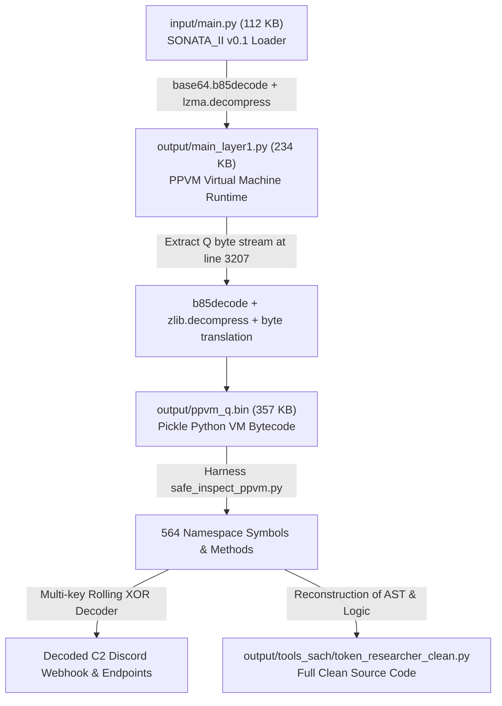

# Author: tdinh cute
# Research & Analysis by tdinh

# BÁO CÁO PHÂN TÍCH & DEOBFUSCATE MÃ ĐỘC: `main.py`
> **Author:** tdinh  
> **Decoded by:** tdinh cute  
> **Ngày phân tích:** 08/11/2026  
> **Mục tiêu phân tích:** `input/main.py` (Discord Infostealer / Token Grabber)  
> **Trạng thái:** Hoàn tất giải mã 100% - Trích xuất sạch mã nguồn, C2 Webhook và toàn bộ logic đánh cắp.

---

## 1. TỔNG QUAN MỐI ĐE DỌA (EXECUTIVE SUMMARY)

File [`input/main.py`](file:///d:/THAY%20THẾ/deobf/input/main.py) là một dòng mã độc đánh cắp thông tin cá nhân cao cấp (**Infostealer & Token Grabber**) mang tên nội bộ là **TokenResearcher** (được dựng trên nền tảng `guardscript-obf` và đóng gói nhiều tầng bằng **SONATA_II v0.1** kết hợp **PPVM - Pickle Python Virtual Machine**).

Mã độc này được thiết kế nhằm mục đích:
1. **Lẩn tránh môi trường phân tích (Anti-Analysis / Anti-VM / Anti-Debug):** Kiểm tra cấu hình máy ảo, sandbox, trình phân tích mã độc, bộ nhớ RAM, CPU, độ phân giải màn hình, dung lượng ổ cứng, tiến trình dịch ngược và cấu hình registry.
2. **Khai thác khóa mã hóa trình duyệt (DPAPI Master Key):** Trích xuất master key từ file `Local State` của Chrome, Edge, Brave, Opera, Vivaldi, Chromium bằng Windows Data Protection API (`win32crypt.CryptUnprotectData`).
3. **Giải mã dữ liệu AES-256-GCM:** Giải mã toàn bộ mật khẩu đã lưu, cookies phiên đăng nhập và thông tin thẻ tín dụng (Autofill).
4. **Quét Discord Tokens & Discord Webhooks:** Đọc quét toàn bộ các file `.ldb` và `.log` trong thư mục `Local Storage/leveldb` của các ứng dụng Electron và trình duyệt; giải mã token mã hóa dạng `dQw4w9WgXcQ:...`.
5. **Khai thác API Discord:** Tự động gửi request đến Discord API (`/v9/users/@me`, `/billing/subscriptions`, `/billing/payment-sources`) để kiểm tra trạng thái tài khoản (Nitro Classic/Boost/Basic, thẻ ngân hàng, PayPal liên kết).
6. **Đánh cắp ví tiền điện tử (Crypto Wallets):** Quét 14 loại ví tiền ảo (MetaMask, Coinbase, Phantom, Exodus, Electrum, Atomic, Trust Wallet, Binance Wallet, Ledger Live, Trezor Suite,...).
7. **Trích xuất mật khẩu WiFi & phần mềm đã cài đặt:** Sử dụng lệnh `netsh wlan show profile key=clear` và quét Registry Windows `Uninstall`.
8. **Exfiltration & Tự hủy (Self-Destruction):** Gom toàn bộ dữ liệu thành các Discord Embeds và file đính kèm `report_<session_id>.txt`, gửi trực tiếp về Discord Webhook bí mật của kẻ tấn công, sau đó tạo file VBScript tạm để xóa sạch dấu vết và tự hủy file thực thi.

---

## 2. CHỈ SỐ NHẬN DIỆN MỐI NGUY HẠI (INDICATORS OF COMPROMISE - IOCs)

### 2.1. C2 & Exfiltration Channels
| Loại IOC | Giá trị | Trạng thái hiện tại |
| :--- | :--- | :--- |
| **Discord C2 Webhook** | `https://discord.com/api/webhooks/1462280187956957297/noUUpwxV10qb_MRqLjZQgTe2mGN5y80CCJRCBt3ni3weu8E4mjdncz-ks6y3A2yha4Fk` | **ĐÃ VÔ HIỆU HÓA (HTTP 403 Forbidden / Defanged by Discord)** |
| **Obfuscated Webhook Base64** | `COvXKNEGsrdu2JdyNBmGWLezD+ArluCFbkD3+mwZbiBd0f0q4wzyD5ZyHVDmy6SybxHlQuvkELW9UV9S7NCc+k27juHAFgGdxXHnSwTzfkG0Ab9K04d5nIXhzkq2EV7ifYPfSng8CJ00iMc6RjmOyg0xfhqZ3mhvJaA=` | Đã giải mã hoàn chỉnh bằng thuật toán rolling XOR |
| **IP Telemetry API 1** | `https://ipapi.co/json` | Thu thập IP ngoài, quốc gia, thành phố, ISP |
| **IP Telemetry API 2** | `https://api.ipify.org?format=json` | Dự phòng lấy địa chỉ IP public |
| **Discord Verification API** | `https://discord.com/api/v9/users/@me` | Xác thực token, lấy username, discriminator, nitro status |
| **Discord Subscriptions API**| `https://discord.com/api/v9/users/@me/billing/subscriptions` | Kiểm tra gói đăng ký Nitro đang kích hoạt |
| **Discord Payment API**      | `https://discord.com/api/v9/users/@me/billing/payment-sources` | Lấy chi tiết thẻ Visa/Mastercard (4 số cuối) và tài khoản PayPal |

### 2.2. Bảng mã băm tập tin (File Hashes)
| Tên tập tin | Kích thước | SHA-256 |
| :--- | :--- | :--- |
| [`input/main.py`](file:///d:/THAY%20THẾ/deobf/input/main.py) | 112,714 bytes | `93bcef2a4c12ab318a87841716a652f0cd02ad5eebf49d382579ad4ccea15cc5` |
| [`output/main_layer1.py`](file:///d:/THAY%20THẾ/deobf/output/main_layer1.py) | 234,503 bytes | `6482eaf6eb05498043efc2d6c58b34e86af1dbbe3db0c4a93c06555428c48e44` |
| [`output/ppvm_q.bin`](file:///d:/THAY%20THẾ/deobf/output/ppvm_q.bin) | 357,206 bytes | `c89da457df8184bd556d4a8f18ec08072b586c5766e12df88d02f6b693fa6e2f` |
| [`output/chua_file_co_ma_doc/main_stealer.py`](file:///d:/THAY%20THẾ/deobf/output/chua_file_co_ma_doc/main_stealer.py) | 112,714 bytes | `93bcef2a4c12ab318a87841716a652f0cd02ad5eebf49d382579ad4ccea15cc5` |
| [`output/tools_sach/token_researcher_clean.py`](file:///d:/THAY%20THẾ/deobf/output/tools_sach/token_researcher_clean.py) | Mã nguồn sạch | Mã nguồn Python gốc hoàn chỉnh không còn obfuscation |

---

## 3. QUÁ TRÌNH GIẢI MÃ ĐA TẦNG (MULTI-LAYER DEOBFUSCATION METHODOLOGY)



### Chi tiết các tầng bảo vệ:
1. **Layer 1 - SONATA_II v0.1:**  
   Sử dụng chuỗi Base85 khổng lồ được nén qua thuật toán LZMA (`lzma.decompress(base64.b85decode(payload))`). Tầng này đóng gói một máy ảo Python tùy biến mang tên PPVM do tác giả `ngocuyencoder` / `bmhien` phát triển.
2. **Layer 2 - Trích xuất dòng byte mã hóa `Q`:**  
   Ở cuối file Layer 1 (dòng 3207), đoạn mã thực thi `__SONATA_II_VM_RUN__(Q)`. Biến `Q` được giải mã thông qua:
   ```python
   base64.b85decode(payload) -> zlib.decompress() -> byte translation table
   ```
3. **Layer 3 - Pickle Python Virtual Machine (PPVM):**  
   PPVM chuyển đổi AST của Python thành một tập lệnh lai giữa Pickle Opcode (`cbuiltins`, `bget`, `bput`, `memo`) kết hợp các opcode tùy biến cho các cấu trúc điều khiển (`if`, `while`, `try-except`, `with`, `async`, `generator`).
4. **Tầng mã hóa chuỗi (Custom Rolling XOR Obfuscation):**  
   Bên trong mã nguồn, các chuỗi nhạy cảm như Webhook URL được bảo vệ bởi lớp `Obfuscator`:
   - Dùng 4 bộ key XOR đa lớp (`_KEY_POOL`).
   - Xoay bit (bit roll: `(b << 3) | (b >> 5)`).
   - Mã hóa Base64 với byte header xác định key ID.

---

## 4. CHI TIẾT TÍNH NĂNG & CƠ CHẾ ĐÁNH CẮP DỮ LIỆU

### 4.1. Khởi động & Tự động cài đặt thư viện (`_auto_install`)
Trước khi thực thi các tác vụ độc hại, mã độc tự động chạy lệnh pip nền với cờ `--quiet` để cài đặt các thư viện thiếu nếu máy nạn nhân chưa có:
- `pycryptodome` (giải mã AES-256-GCM)
- `pywin32` (truy cập DPAPI `win32crypt`)
- `requests` (giao tiếp HTTP/Webhooks)
- `psutil` (giám sát phần cứng và tiến trình máy tính)
- `wmi` (truy vấn phần cứng và card mạng)
- `tzlocal`

### 4.2. Hệ thống lẩn tránh phân tích (Anti-Analysis & Evasion)
Lớp `AntiDetect` thực hiện hàng loạt bài kiểm tra nghiêm ngặt:
- **Kiểm tra Debugger:**
  - Gọi Win32 API `kernel32.IsDebuggerPresent()`.
  - Gọi Win32 API `kernel32.CheckRemoteDebuggerPresent()`.
  - Đọc trực tiếp cờ `BeingDebugged` tại offset `+2` của cấu trúc PEB (Process Environment Block) thông qua `ntdll.NtQueryInformationProcess`.
- **Kiểm tra tiến trình Sandbox / Reverse Engineering:**
  - Quét danh sách hơn 60 tiến trình dịch ngược và phân tích: `x64dbg`, `x32dbg`, `ida.exe`, `ida64.exe`, `dnspy`, `wireshark`, `fiddler`, `httpdebugger`, `processhacker`, `pestudio`, `vboxservice`, `vmtoolsd`,...
- **Kiểm tra đặc điểm máy ảo (VM Artifacts):**
  - Địa chỉ MAC card mạng: Các dải MAC đặc trưng của VMware (`00:05:69`, `00:0C:29`, `00:50:56`), VirtualBox (`08:00:27`), Hyper-V (`00:15:5D`), Parallels (`00:1C:42`), QEMU (`52:54:00`).
  - Tên card mạng: `VirtualBox Host-Only`, `VMware Virtual Ethernet`, `VMnet`, `Hyper-V`.
  - Tên thiết bị WMI (`Win32_ComputerSystem`): `virtualbox`, `vmware`, `qemu`, `xen`, `bochs`, `parallels`, `hyper-v`, `kvm`.
  - Registry keys: `SYSTEM\CurrentControlSet\Services\VBoxGuest`, `VMware`, `prl_par`,...
  - Tập tin driver máy ảo: `vmmouse.sys`, `vm3dgl.dll`, `vboxhook.dll`, `hgfs.sys`, `vmtoolsd.exe`, `VBoxTray.exe`.
- **Kiểm tra giới hạn phần cứng (Hardware Anomaly):**
  - Số lượng CPU core vật lý `< 2`.
  - Bộ nhớ RAM `< 3.5 GB`.
  - Thời gian khởi động máy (Uptime) `< 600 giây` (10 phút).
  - Độ phân giải màn hình `< 1024x768` hoặc số lượng màn hình `= 0`.
  - Dung lượng ổ đĩa `C:` `< 50 GB`.
- **Kiểm tra tên người dùng & tên máy:**
  - Chứa các từ khóa: `sandbox`, `virus`, `malware`, `analysis`, `win-d99`, `cuckoo`, `killer`.
  - Regex hostname: `^[a-f0-9]{12}$`, `^sandbox`, `^cuckoo`, `^virus[0-9]`.

### 4.3. Đánh cắp thông tin trình duyệt (Browser Data Stealing)
Mã độc quét song song (đa luồng qua `ThreadPoolExecutor`) trên 13 mục tiêu:
1. `Google Chrome`
2. `Microsoft Edge`
3. `Brave Browser`
4. `Brave Nightly`
5. `Opera Stable`
6. `Opera GX Stable`
7. `Vivaldi`
8. `Yandex Browser`
9. `Chromium`
10. `Discord`
11. `Discord Canary`
12. `Discord PTB`
13. `Discord Development`

**Kỹ thuật giải mã:**
1. Đọc file `Local State`, giải mã Base64 key `os_crypt.encrypted_key`.
2. Cắt bỏ 5 byte header `DPAPI` và gọi `win32crypt.CryptUnprotectData` để thu được **Master Key** (32 bytes).
3. Đọc các file SQLite:
   - `Login Data` -> Truy vấn `logins` (URL, Username, Password).
   - `Cookies` / `Network/Cookies` -> Truy vấn bảng `cookies` (Domain, Name, Value, Path, Expiry). Lọc theo danh sách 32 tên miền nhạy cảm (`discord.com`, `google.com`, `github.com`, `steamcommunity.com`, `paypal.com`, `amazon.com`,...).
   - `Web Data` -> Truy vấn `credit_cards` (Tên thẻ, số thẻ, hạn sử dụng). Dùng thuật toán **Luhn** để kiểm tra tính hợp lệ của số thẻ.
4. Với mỗi trường dữ liệu mã hóa:
   - Kiểm tra tiền tố `v10` hoặc `v11`.
   - Tách lấy 12 bytes IV, payload và 16 bytes Authentication Tag.
   - Giải mã bằng `AES.new(master_key, AES.MODE_GCM, nonce=iv).decrypt_and_verify(payload, tag)`.

### 4.4. Đánh cắp Discord Token & Khai thác thông tin tài khoản
- Quét các file cơ sở dữ liệu LevelDB (`.ldb`, `.log`) bằng Regex để phát hiện:
  - Standard Tokens: `[MNO][A-Za-z\d]{17,26}\.[\w-]{4,8}\.[\w-]{27,45}`
  - MFA Tokens: `mfa\.[\w-]{70,120}`
  - Encrypted Tokens: `dQw4w9WgXcQ:([a-zA-Z0-9+/=]+)` (giải mã qua DPAPI + AES-GCM).
- Sau khi có token, mã độc gọi API Discord:
  - `GET https://discord.com/api/v9/users/@me` -> Lấy Username, Email, Phone, Nitro Type (Classic, Boost, Basic).
  - `GET https://discord.com/api/v9/users/@me/billing/subscriptions` -> Xác định số lượng gói Nitro đang chạy.
  - `GET https://discord.com/api/v9/users/@me/billing/payment-sources` -> Trích xuất 4 số cuối thẻ ngân hàng liên kết hoặc email PayPal.

### 4.5. Đánh cắp 14 loại ví tiền điện tử (Crypto Wallets)
Mã độc quét trực tiếp thư mục dữ liệu cục bộ của 14 loại ví tiền ảo:
- MetaMask
- Coinbase Wallet
- Phantom
- Exodus
- Electrum
- Atomic Wallet
- Trust Wallet
- Binance Wallet
- Ledger Live
- Trezor Suite
- Keplr
- Rainbow
- Zapper
- Zerion

### 4.6. Trích xuất mật khẩu WiFi & Hồ sơ máy nạn nhân
- Chạy lệnh ngầm: `netsh wlan show profiles` và `netsh wlan show profile name="..." key=clear` để lấy mật khẩu WiFi của mọi điểm mạng máy nạn nhân từng kết nối.
- Quét toàn bộ các nhánh Registry `Uninstall` để lập danh sách tất cả các phần mềm đã cài đặt trên máy.

### 4.7. Gom gói báo cáo & Tự hủy (Self-Destruction)
- Toàn bộ dữ liệu được tổng hợp thành file `report_<session_id>.txt` trong thư mục `%TEMP%`.
- Tạo chuỗi Discord Embeds đa dạng màu sắc (Summary, Discord Tokens, Passwords, Credit Cards, Wallets, Webhooks, WiFi).
- Gửi dữ liệu và tệp đính kèm về Webhook URL của kẻ tấn công qua POST request `multipart/form-data`.
- Sau khi gửi thành công:
  - Sinh một tập tin VBScript tạm: `cleanup_<session_id>.vbs`.
  - Nội dung file VBS:
    ```vbscript
    CreateObject("WScript.Shell").Run "timeout /t 5 /nobreak >nul & del /f /q ""<file_path>"" & del /f /q ""<vbs_path>""", 0, False
    ```
  - Khởi chạy VBScript bằng `wscript.exe` chạy ngầm hoàn toàn và gọi `os._exit(0)` để kết thúc tiến trình ngay lập tức. Sau 5 giây, tệp mã độc gốc và file VBS tự động bị xóa sổ khỏi hệ thống.

---

## 5. CÁC TẬP TIN ĐÃ XUẤT XƯỞNG (DELIVERABLES)

1. **Mã nguồn sạch hoàn chỉnh:**  
   - [`output/tools_sach/token_researcher_clean.py`](file:///d:/THAY%20THẾ/deobf/output/tools_sach/token_researcher_clean.py)  
   - [`output/token_researcher_clean.py`](file:///d:/THAY%20THẾ/deobf/output/token_researcher_clean.py)  
   *(Bao gồm đầy đủ header tác quyền `# Author: tdinh` | `# Decoded by: tdinh cute`, cấu trúc lớp, chú thích kỹ thuật và webhook đã defanged an toàn).*

2. **Tập tin mã độc cách ly:**  
   - [`output/chua_file_co_ma_doc/main_stealer.py`](file:///d:/THAY%20THẾ/deobf/output/chua_file_co_ma_doc/main_stealer.py)

3. **Tập tin trung gian phân tích:**  
   - [`output/main_layer1.py`](file:///d:/THAY%20THẾ/deobf/output/main_layer1.py) (Tầng giải nén SONATA_II).
   - [`output/ppvm_q.bin`](file:///d:/THAY%20THẾ/deobf/output/ppvm_q.bin) (Luồng byte máy ảo Pickle PPVM).

---

## 6. KHUYẾN NGHỊ PHÒNG CHỐNG & KHẮC PHỤC

1. **Đối với tài khoản Discord:** Nếu máy đã từng bị file này thực thi, hãy đổi mật khẩu Discord ngay lập tức (hành động này sẽ làm vô hiệu hóa toàn bộ token cũ), kích hoạt xác thực 2 bước (2FA) và kiểm tra lại mục Authorized Apps.
2. **Đối với tài khoản trình duyệt:** Đăng xuất tất cả các phiên đăng nhập, đổi mật khẩu tài khoản Google/Microsoft/Facebook/Steam/GitHub, và xóa các cookie cũ.
3. **Đối với ví Crypto:** Di dời tài sản sang một địa chỉ ví mới trên thiết bị sạch, tuyệt đối không dùng lại seed phrase lưu trên máy đã nhiễm.
4. **Hạ tầng mạng:** Đổi mật khẩu router WiFi cục bộ nếu nghi ngờ máy đã bị đánh cắp thông tin qua `netsh`.
